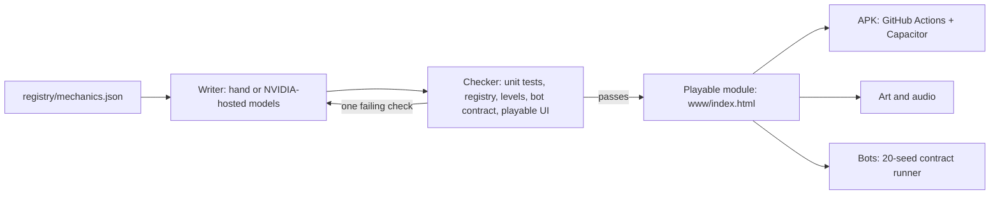

<div align="center">

# GAME OF EVERYTHING

**A library of 2D game mechanics. Each one is a small, tested, playable, offline-first module.**


</div>

> **Early and private.** 37 mechanics are playable today across Action, Puzzle, Shooter, Platformer, Cards & Board, Strategy, RPG, Roguelike, Adventure, Simulation, Survival, Racing, Idle, and Rhythm families (35 with full bot interfaces and automated multi-seed simulation checks). Everything else is a registry entry waiting to be written. This README says what exists and what is planned, and tries not to blur the two.

## Why

Most hit mobile games are a small set of mechanics wearing different art. If every mechanic exists as a clean, tested module with a standard interface, then:

- a new game is a mechanic plus original art, sound and levels, not a fresh codebase;
- AI writers can produce modules quickly, and a machine checker (tests) decides whether they are right;
- bots can play every module, which gives difficulty and solvability numbers instead of guesses.

## Progress

<!-- STATUS:START -->
**Playable: 140 / 179** `███████████████████░░░░░`

Logic with tests or better: 140 / 179 · Bot interface: 138 / 179 · Data levels: 6

| Stage | Mechanics |
|---|---|
| idea | 39 |
| spec | 0 |
| logic | 0 |
| playable | 140 |
| polished | 0 |
| shipped | 0 |

Full table: [registry/STATUS.md](registry/STATUS.md)
<!-- STATUS:END -->

## How it works



Every `bot: true` mechanic implements a deterministic pure-JSON state machine verified across 20 random-bot seeds (`npm run bots:check`), and every `playable` mechanic is smoke-tested in a sandboxed canvas/PWA harness (`npm run playable:check`). An automated writer-checker prototype lives in `tools/writer/loop.py`. See [docs/PIPELINE.md](docs/PIPELINE.md).

## Quick start

Requires Node 22 or newer.

```bash
npm run setup     # enable the pre-commit secret check
npm run verify    # tests + registry + levels + bots + playable + status + secret scan
```

Play a mechanic in the browser:

```bash
python -m http.server 8123
# open http://localhost:8123/mechanics/0002-block-placement-puzzle/www/
```

Build a debug APK on GitHub (no Android tools needed locally):

```bash
gh workflow run apk.yml -f mechanic=0002
```

## Repository layout

```text
registry/        the list of mechanics and their status (mechanics.json is the source of truth)
mechanics/       one folder per mechanic: <id>-<slug>/{www/logic.js, www/index.html, test.js}
platform/        shared Android shell (Capacitor) used by the APK workflow
tools/           registry check, status generator, secret scan, APK prep, NVIDIA model tools
docs/            vision, architecture, mechanic spec, pipeline, roadmap, legal notes, benchmarks
.github/         CI, APK workflow, issue and PR templates
```

## Principles

1. **Mechanics are ideas; expression is owned.** We reimplement rules, never names, art, sounds, levels or text. See [docs/LEGAL.md](docs/LEGAL.md).
2. **Logic is pure and tested.** No DOM, no clock, seeded randomness.
3. **Tests are independent.** The author of a module does not get to be the only author of its tests.
4. **Offline first.** Every module works with no network.
5. **Secrets stay out.** Keys live outside the repository and a hook plus CI refuse them.

## Docs

[Vision](docs/VISION.md) · [Architecture](docs/ARCHITECTURE.md) · [Mechanic spec](docs/MECHANIC-SPEC.md) · [Levels](docs/LEVELS.md) · [Pipeline](docs/PIPELINE.md) · [Roadmap](docs/ROADMAP.md) · [Legal notes](docs/LEGAL.md) · [Model benchmarks](docs/benchmarks/README.md) · [Contributing](CONTRIBUTING.md) · [Security](SECURITY.md)

## License

[MIT](LICENSE). This is a placeholder choice while the repository is private; revisit before making it public.
