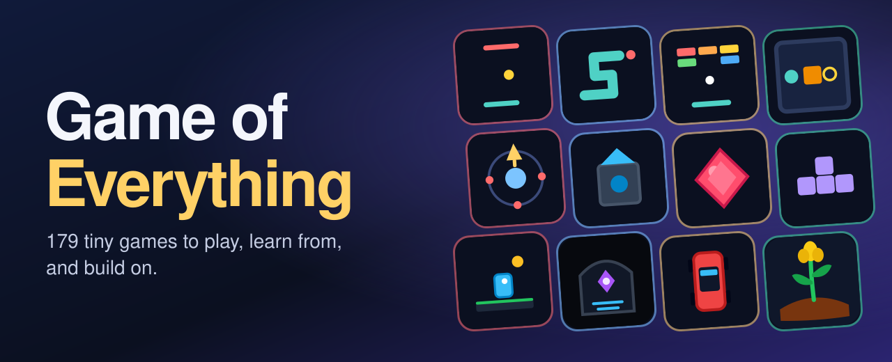
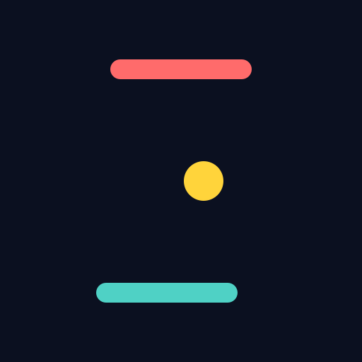
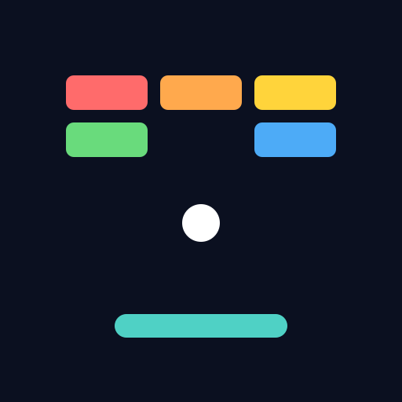
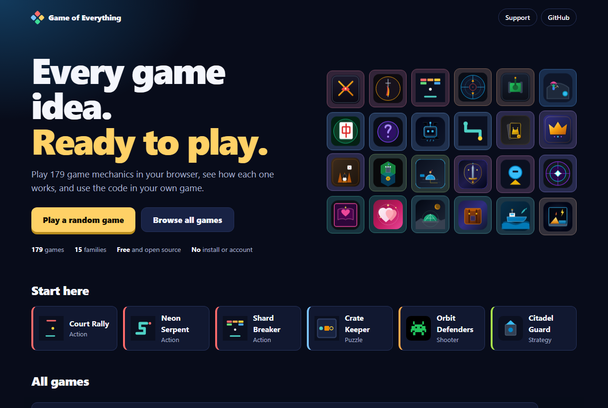

<div align="center">

<a href="https://layer8labs8.github.io/GAME-OF-EVERYTHING/"></a>

### Ever wondered how your favorite kind of game actually works?

Open one, play it, then read exactly how it's built. No install, no account, and no ads.

[](https://layer8labs8.github.io/GAME-OF-EVERYTHING/)
[](https://github.com/layer8labs8/GAME-OF-EVERYTHING/issues?q=is%3Aissue+is%3Aopen+label%3A%22good+first+issue%22)
[](https://github.com/layer8labs8/GAME-OF-EVERYTHING/stargazers)

</div>

## Pick a game and play

Click any game. It opens right in your browser.

<table>
<tr>
<td align="center" width="25%"><a href="https://layer8labs8.github.io/GAME-OF-EVERYTHING/#play=0017-court-rally"><br><b>Court Rally</b></a><br><sub>Action</sub></td>
<td align="center" width="25%"><a href="https://layer8labs8.github.io/GAME-OF-EVERYTHING/#play=0016-snake"><br><b>Neon Serpent</b></a><br><sub>Action</sub></td>
<td align="center" width="25%"><a href="https://layer8labs8.github.io/GAME-OF-EVERYTHING/#play=0018-shard-breaker"><br><b>Shard Breaker</b></a><br><sub>Action</sub></td>
<td align="center" width="25%"><a href="https://layer8labs8.github.io/GAME-OF-EVERYTHING/#play=0042-falling-blocks"><br><b>Quad Drop</b></a><br><sub>Puzzle</sub></td>
</tr>
<tr>
<td align="center" width="25%"><a href="https://layer8labs8.github.io/GAME-OF-EVERYTHING/#play=0043-sokoban"><br><b>Crate Keeper</b></a><br><sub>Puzzle</sub></td>
<td align="center" width="25%"><a href="https://layer8labs8.github.io/GAME-OF-EVERYTHING/#play=0031-orbit-defenders"><br><b>Orbit Defenders</b></a><br><sub>Shooter</sub></td>
<td align="center" width="25%"><a href="https://layer8labs8.github.io/GAME-OF-EVERYTHING/#play=0101-tower-defense"><br><b>Citadel Guard</b></a><br><sub>Strategy</sub></td>
<td align="center" width="25%"><a href="https://layer8labs8.github.io/GAME-OF-EVERYTHING/#play=0041-match-3"><br><b>Gem Cascade</b></a><br><sub>Puzzle</sub></td>
</tr>
<tr>
<td align="center" width="25%"><a href="https://layer8labs8.github.io/GAME-OF-EVERYTHING/#play=0033-2d-platformer"><br><b>Pixel Jumper</b></a><br><sub>Platformer</sub></td>
<td align="center" width="25%"><a href="https://layer8labs8.github.io/GAME-OF-EVERYTHING/#play=0121-roguelike"><br><b>Abyssal Crypt</b></a><br><sub>Roguelike</sub></td>
<td align="center" width="25%"><a href="https://layer8labs8.github.io/GAME-OF-EVERYTHING/#play=0172-racing"><br><b>Speedway Rush</b></a><br><sub>Racing</sub></td>
<td align="center" width="25%"><a href="https://layer8labs8.github.io/GAME-OF-EVERYTHING/#play=0145-farming-sim"><br><b>Harvest Haven</b></a><br><sub>Simulation</sub></td>
</tr>
</table>

<p align="center"><b><a href="https://layer8labs8.github.io/GAME-OF-EVERYTHING/">See all 179 games</a></b></p>

<p align="center"><a href="https://layer8labs8.github.io/GAME-OF-EVERYTHING/"></a></p>

## What can you do here?

| | |
|---|---|
| **Play** | Try puzzles, shooters, card games, racers, farming sims, and more, all in one place. |
| **Learn** | Every game shows its rules in plain text, so you can see how the idea really works. |
| **Build** | Copy a mechanic into your own game. It's MIT licensed, so it's yours to use. |
| **Experiment** | Teach a bot to play. The rules run without a screen, so your code can play too. |

A game mechanic is the idea that makes a game fun, such as matching three tiles or jumping over gaps. This project keeps each one as a small working game, so you can learn from it without digging through a huge codebase.

**Puzzle** 32 · **Simulation** 22 · **Action** 20 · **Strategy** 20 · **Cards & Board** 17 · **Adventure** 13 · **RPG** 12 · **Shooter** 11 · **Platformer** 8 · **Roguelike** 6 · **Survival** 5 · **Racing** 5 · **Idle** 3 · **Other** 3 · **Rhythm** 2

## Use a mechanic in your own project

Every game keeps its rules in one small file, separate from the graphics:

```js
const game = require('./mechanics/0017-court-rally/www/logic.js');

const state = game.createState(1); // The same seed gives the same game
while (!game.isOver(state)) {
  game.step(state, game.legalActions(state)[0]);
}
console.log(game.score(state));
```

That's a tiny bot playing a full match. Most games share these same functions, so what you learn from one works on the rest.

<details>
<summary>What's inside each game?</summary>

Each game has its own folder in [`mechanics/`](mechanics), such as [`0017-court-rally`](mechanics/0017-court-rally):

| File | What it is |
|---|---|
| `www/index.html` | The game you play |
| `www/logic.js` | The rules, with no graphics |
| `SPEC.md` | The rules written in words |
| `test.js` | Tests that prove the rules work |

To run a game on your own computer:

```bash
python -m http.server 8123
```

Then open <http://localhost:8123/mechanics/0017-court-rally/www/>.

</details>

## Come build with us

The project is young, and there's a lot of fun work left. You don't need to be an expert, and your first pull request can be small.

- **Add a new game:** Tic-tac-toe, Mancala, Nonogram, and more are waiting.
- **Make a game better:** add sound, levels, or a better feel.
- **Explain it simply:** rewrite a mechanic so a beginner gets it.
- **Tell us what's broken:** bug reports help too.

**[Pick a starter task](https://github.com/layer8labs8/GAME-OF-EVERYTHING/issues?q=is%3Aissue+is%3Aopen+label%3A%22good+first+issue%22)**, then follow [CONTRIBUTING.md](CONTRIBUTING.md). Games use original names, art, and levels, as explained in [docs/LEGAL.md](docs/LEGAL.md).

## Thank you

If this project helped you, I'm really glad. If you'd like to support it, you can [send a crypto tip on the website](https://layer8labs8.github.io/GAME-OF-EVERYTHING/#support). If not, that's completely okay. A star or telling a friend means a lot too.

<details>
<summary>Project progress</summary>

<!-- STATUS:START -->
**Playable: 179 / 179** `████████████████████████`

Logic with tests or better: 179 / 179 · Bot interface: 177 / 179 · Data levels: 6

| Stage | Mechanics |
|---|---|
| idea | 0 |
| spec | 0 |
| logic | 0 |
| playable | 179 |
| polished | 0 |
| shipped | 0 |

Full table: [registry/STATUS.md](registry/STATUS.md)
<!-- STATUS:END -->

</details>

**More:** [Vision](docs/VISION.md) · [Architecture](docs/ARCHITECTURE.md) · [Mechanic spec](docs/MECHANIC-SPEC.md) · [Levels](docs/LEVELS.md) · [Roadmap](docs/ROADMAP.md) · [Security](SECURITY.md) · [MIT License](LICENSE)
