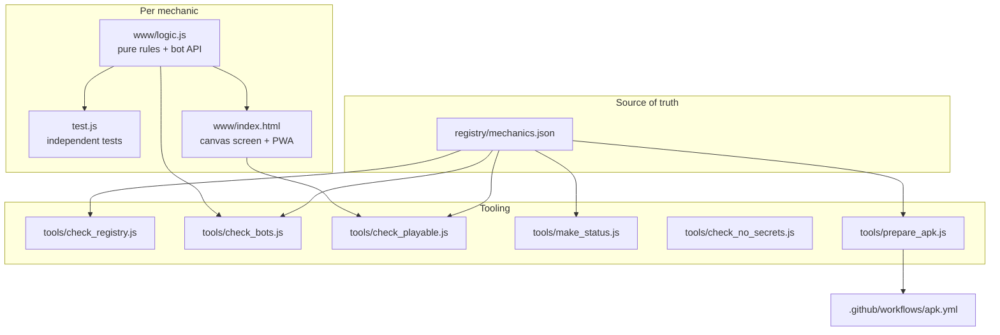

# Architecture

## Folders

| Path | Purpose |
|---|---|
| `registry/mechanics.json` | Every mechanic: id, slug, name, family, status, bot flag, source. The only hand-edited index. |
| `registry/STATUS.md` | Generated table of progress. Never edited by hand. |
| `mechanics/<id>-<slug>/` | One module. Self-contained: it can be opened from a static file server. |
| `platform/android/` | `package.json` and lock file for the Capacitor shell. No Android project is committed; the workflow generates it. |
| `tools/` | Zero-dependency Node scripts, plus Python tools for NVIDIA models in `tools/nvidia/`. |
| `docs/` | Documentation and benchmark records. |

## Why no `android/` folder per game

A Capacitor Android project is about 60 files. Committing one per mechanic would bury the repository in generated files. The APK workflow instead generates the project from `platform/android/package.json`, copies the mechanic's `www/`, writes `capacitor.config.json`, patches the manifest to portrait, and builds with Gradle.

## APK flow

1. `workflow_dispatch` with a mechanic id.
2. Run that mechanic's tests. A failing test stops the build before any Gradle minutes are spent.
3. `tools/prepare_apk.js` builds `build/apk/` (www, config, package files).
4. `npm ci`, `npx cap add android`, manifest patch, `npx cap sync android`.
5. `./gradlew assembleDebug`, upload the APK as an artifact kept for 3 days.

Builds are manual on purpose: building every mechanic would use about a month of free Actions minutes in one run.

## Keys

The NVIDIA key is not in the repository and never should be. Tools read `NVIDIA_API_KEY`, or a file named by `NVIDIA_KEY_FILE`, or `nvidia.txt` in the folder that contains the repository. The pre-commit hook and CI both scan for keys.
